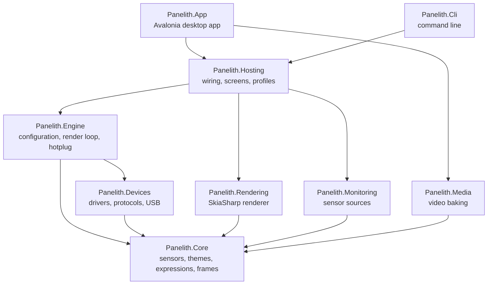

# Architecture

Panelith is a .NET 10 solution ([`Panelith.slnx`](../Panelith.slnx)) of small projects with one-way dependencies.

| Project | Responsibility |
| --- | --- |
| `Panelith.Core` | The domain model: sensor ids, readings and snapshots; well-known theme values; the theme document; the binding expression language and value formatter; frame buffers and panel descriptors. No I/O. |
| `Panelith.Devices` | USB transports (libusb, WinUSB, HID, serial, SCSI), the wire protocols, panel drivers and the data-driven panel profiles. |
| `Panelith.Monitoring` | Sensor sources: LibreHardwareMonitor, HWiNFO shared memory, RivaTuner, Windows system information, Linux hwmon and `/proc`, and a synthetic source for demos and tests. |
| `Panelith.Rendering` | Draws a theme into a frame with SkiaSharp, encodes JPEG and RGB565, caches clips and pictures. |
| `Panelith.Engine` | Loads configuration, discovers panels, and runs one supervised render-and-send loop per panel, with reconnects, frame-rate caps and duplicate-frame skipping. |
| `Panelith.Hosting` | Puts sensors, panels and screens together for both front ends: the screen library, the switchable renderer, screen editing, and profiles with their rules. |
| `Panelith.Media` | Turns videos into `.ptclip` files with Windows Media Foundation, in a child process, and exports MP4 copies. |
| `Panelith.App` | The Avalonia desktop app: pages, the designer, video import, activity detection for profiles, the tray, start-up integration, session restore and updates. |
| `Panelith.Cli` | The `panelith` command. |

## Data flow

1. Sensor sources are polled once a second into a `SensorHub`, which keeps history for graphs and resolves theme values such as `@cpu.temp` to this machine's sensors.
2. For each panel, the engine asks the active renderer for a frame at the panel's size. The renderer evaluates the screen's bindings against the latest snapshot and draws it.
3. If the frame differs from the last one, the driver encodes it in the panel's format and sends it.
4. The app's `ProfileController` checks running programs, idle time and the clock every two seconds and switches the renderer's screen, dimming and frame rate when another profile applies.

## Tests

`tests/` has one test project per source project, around 450 tests in all. They need no hardware: protocol tests check byte layouts against recorded examples, and the virtual panel runs the real render loop end to end. Run them with `dotnet test Panelith.slnx`.
