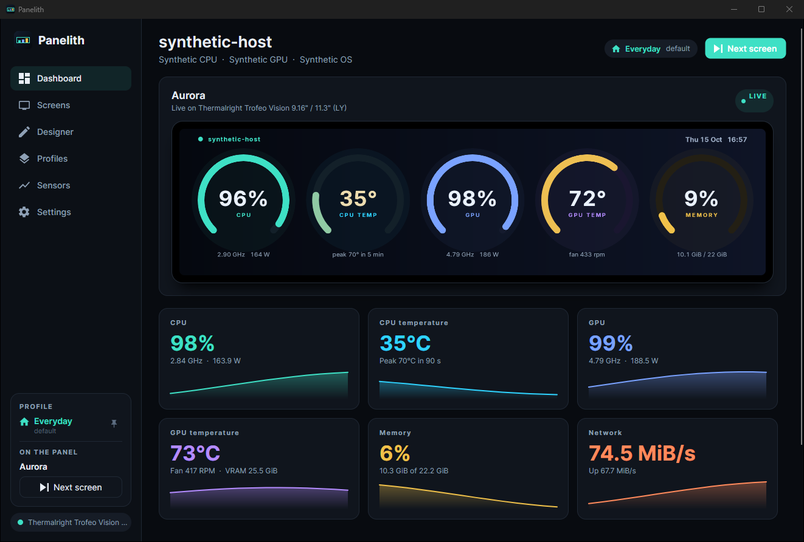

# Getting started

## 1. Connect the panel

Plug the panel in and close its own software first. Thermalright TRCC in particular keeps the panel to itself, even from the notification area.

Start Panelith. The status at the bottom left of the window says what it found:

- **Thermalright Trofeo Vision · 15 fps**: the panel is live.
- **connecting**: Panelith found the panel and is opening it.
- **No panel connected**: nothing it recognises is plugged in. See [The panel stays dark](troubleshooting.md#the-panel-stays-dark).

Windows needs no extra drivers for the Trofeo Vision: the 6.86" panel uses the standard HID driver, and the 9.16" and 11.3" panels announce themselves as WinUSB devices, which Windows binds automatically the first time they are plugged in.

## 2. Look at the Dashboard

The **Dashboard** shows exactly what the panel is showing, live, together with the main readings: CPU, GPU, memory and network, with a short history.

The card at the bottom left shows the active **profile** and the screen **on the panel**. **Next screen** steps to the next one.

## 3. Pick a screen

Open **Screens** and click any screen to put it on the panel. Tick **In rotation** on several and turn on **Rotate screens** to cycle between them. See [Screens](screens.md).

## 4. Get every sensor

Most CPUs only report temperature, clock and power to programs running as administrator, through a driver called PawnIO. If the CPU tiles on the Dashboard show `--`:

1. Install PawnIO from **Settings > Sensors** (or tick it in the installer).
2. Choose **Restart as administrator** on the same page.
3. To start that way every time without a prompt, turn on **Start with Windows** while running as administrator. Panelith then starts elevated at sign-in through a scheduled task.

For in-game FPS, install and run [RivaTuner Statistics Server](https://www.guru3d.com/download/rtss-rivatuner-statistics-server-download/) (it comes with MSI Afterburner). See [Sensors](sensors.md).

## 5. Leave it running

Closing the window keeps Panelith running in the notification area, so the panel stays live. Click the tray icon to bring the window back, or right-click it to switch screens and profiles or to quit. Panelith remembers the window's size, position and page for next time.

## Next steps

- Let the panel switch by itself with [Profiles](profiles.md).
- Turn a video into a screen with [Video screens](video-screens.md).
- Build your own with the [Designer](designer.md).
- Use the [global shortcuts](settings.md#shortcuts): **Ctrl+Alt+Right** for the next screen and **Ctrl+Alt+P** for the next profile, even inside a game.
