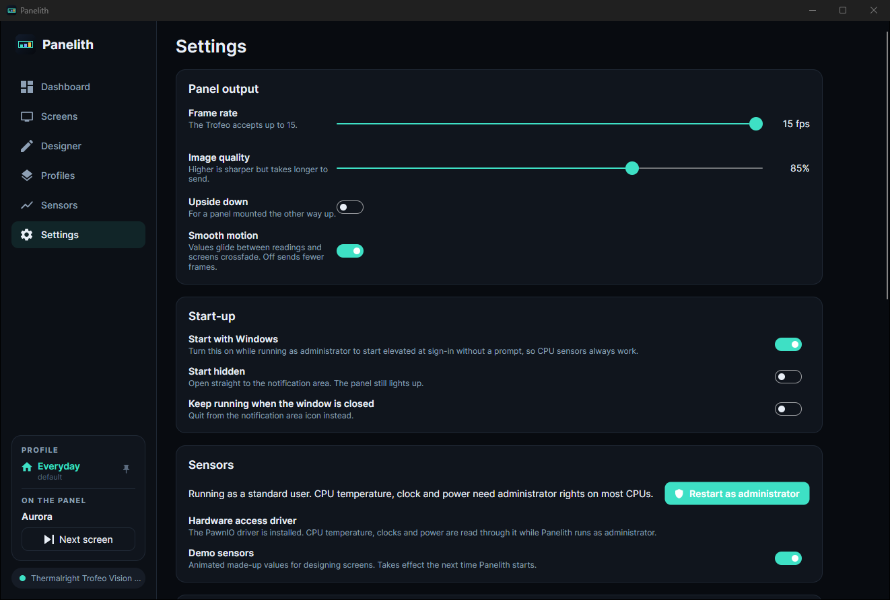

# Settings

## Panel output

| Setting | What it does |
| --- | --- |
| **Frame rate** | How many pictures a second are sent, up to the panel's limit (15 for the Trofeo Vision). Lower uses less CPU and USB bandwidth. |
| **Image quality** | JPEG quality for panels that take JPEG. Higher is sharper but each frame takes longer to send. |
| **Upside down** | For a panel mounted the other way up. |
| **Smooth motion** | Values glide between readings, screens crossfade and dimming fades. Off sends fewer frames. |

Frame rate, quality and orientation need the panel connection reopened: change them, then choose **Apply**. They are saved in `panelith.json`, which the command line shares.

## Start-up

| Setting | What it does |
| --- | --- |
| **Start with Windows** | Starts Panelith when you sign in. Turned on while running as administrator, it uses a scheduled task that starts Panelith elevated without a prompt, so CPU sensors always work. |
| **Always run as administrator** | On by default. Every time Panelith opens without administrator rights, including from the Start menu or at sign-in, it asks Windows for them so CPU sensors work. Saying no only skips that one launch; the next one asks again. Turn this off to stop the prompt; the choice is saved. When **Start with Windows** is on as well, the next elevated run switches it to the scheduled task, so sign-in starts elevated without a prompt at all. |
| **Start hidden** | Starts in the notification area without opening the window. The panel still lights up. |
| **Keep running when the window is closed** | Closing the window hides it to the notification area. Turn off to quit when the window closes. |

Elevated start-up is only offered when Panelith is installed in Program Files, where standard users cannot change its files. If **Start with Windows** is already on when Panelith notices it is running elevated, it upgrades the sign-in entry to the elevated scheduled task by itself, so a restart comes back up the same way.

## Sensors

- **Restart as administrator** restarts Panelith elevated, for CPU temperature, clock and power.
- **Install PawnIO** installs the hardware-access driver most CPUs need for those readings.
- **Add Media Feature Pack** appears on Windows N editions, which need it for video screens.
- **Demo sensors** uses animated made-up values instead of real ones, from the next start.

## Shortcuts

Global shortcuts work anywhere in Windows, even in a fullscreen game:

- **Next screen**, default **Ctrl+Alt+Right**
- **Next profile**, default **Ctrl+Alt+P**

Click a box and press the keys; **Backspace** clears it. Each profile can also have its own shortcut on the [Profiles](profiles.md) page. If another program already uses a shortcut, Panelith says so here.

## In-game FPS

Shows whether RivaTuner Statistics Server is installed, running and measuring a game, with a link to get it. See [Sensors](sensors.md).

## Updates

Shows the version you have and whether a newer one is available.

- **Check for updates automatically** (the switch): Panelith checks a minute after it starts and every six hours after that.
- **Check now** checks straight away.
- **Install … and restart** downloads the new version, checks its signature, then asks Windows for permission to install it (it writes to Program Files, so it always needs this, whether or not Panelith itself is currently running elevated). Approve that prompt and Panelith closes, installs and starts again on its own. Decline it and Panelith keeps running on the old version; **Install** tries again.
- **What's new** opens the release notes.

See [Updates](updates.md).

## Files

Opens the folder with your screens, and the folder with configuration and logs. See [Configuration files](configuration.md).

## Activity

The most recent 200 lines of Panelith's log: panels connecting, profiles switching, problems. The full log is in `%APPDATA%\Panelith\logs`, kept for 14 days. Attach it when you [report a problem](troubleshooting.md#reporting-a-problem).
